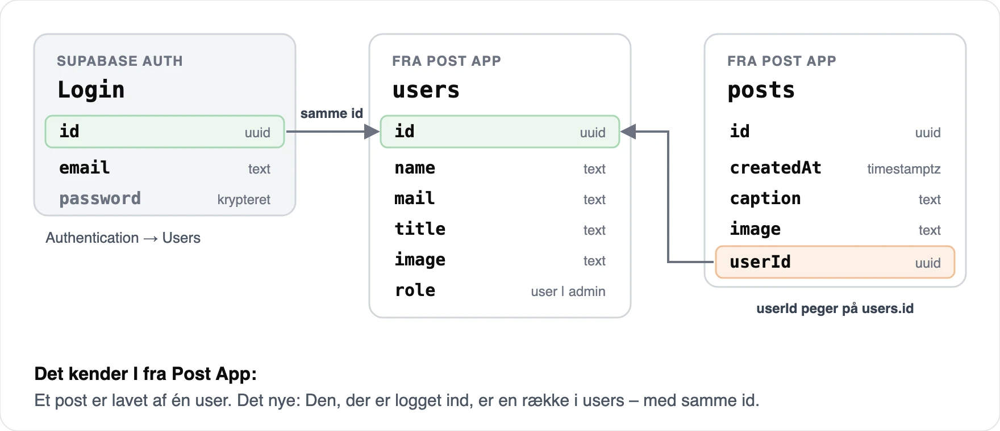
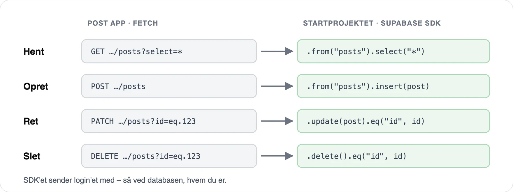
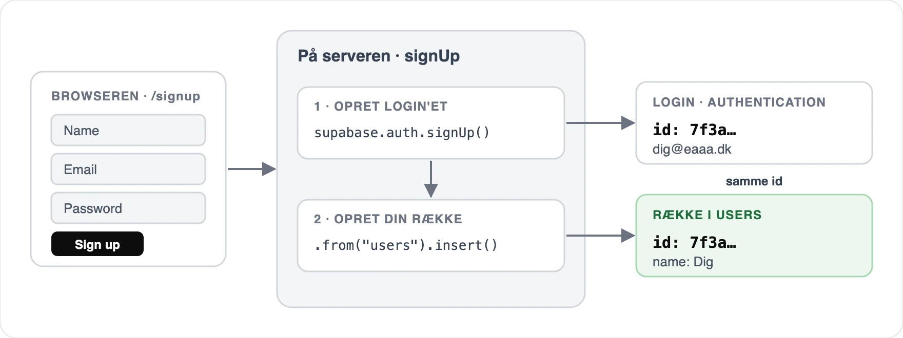
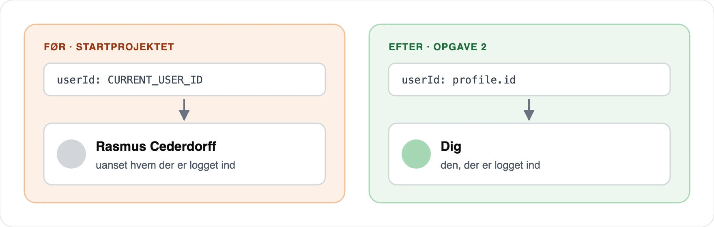
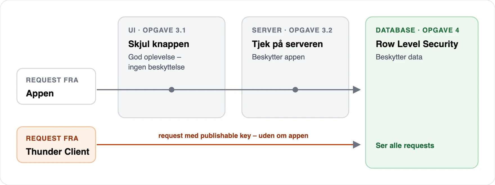
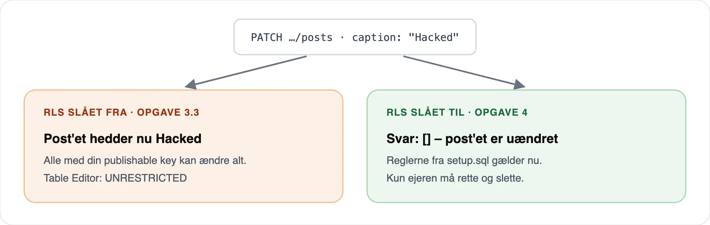

# Opgave: User management og beskyttet adgang - 10-11-2026

## Formål

Du kender relationen fra Post App: Et post er lavet af én user, og en user kan lave mange posts. I dag kobler du den til login: Nye posts skal tilhøre den, der er logget ind, og kun ejeren må rette og slette dem – i appen og i databasen.



**Det nye i dag:** Den, der er logget ind, er en række i `users` – med samme `id` som login'et.

<hr style="margin: 2rem 0;">

## Sådan bruger du opgaven

- **I startprojektet først:** Start med opgave 1. Brug dit Supabase-projekt fra 30. oktober – ikke jeres gruppeprojekt, for `setup.sql` sletter og opretter tabellerne `users` og `posts`.
- **Direkte i jeres projekt:** Følg trinene i jeres egen app, og brug startprojektet som opslag.

Undervejs:

- Slut hvert trin med **Tjek**. Sidder du fast? Fold **Hint** og **Løsning** ud.
- Commit og push efter hver opgave med Source Control i VS Code eller GitHub Desktop.
- Du skal ikke skrive SQL. Hele databasen kommer fra én fil, `supabase/setup.sql`.

<hr style="margin: 2rem 0;">

## Oversigt

1. [Kom i gang](#opgave-1)
2. [Posts får en ejer](#opgave-2)
3. [Kun ejeren kan rette og slette](#opgave-3)
4. [Beskyt databasen](#opgave-4)

**Ekstra, når du er færdig:** [Ret din profil og admin](#ekstra)

Sidder du fast? Se [Fejlfinding](#fejlfinding).

<hr style="margin: 2rem 0;">

<a id="opgave-1"></a>

## Opgave 1: Kom i gang

**Resultat:** Appen kører, og du ved, hvordan den henter data, og hvem der er logget ind.

### 1.1 Dit eget repository

1. Åbn [nextjs-supabase-posts](https://github.com/cederdorff/nextjs-supabase-posts) på GitHub. Klik på **Use this template → Create a new repository**, giv det et navn, og klik på _Create repository_.
2. Klon dit nye repository i VS Code (_Clone Git Repository_) eller GitHub Desktop (_File → Clone Repository_).
3. Åbn mappen i VS Code, og kør i terminalen:

   ```bash
   npm install
   ```

### 1.2 Gør Supabase klar

Brug dit Supabase-projekt fra 30. oktober. Står det som _Paused_, så klik på _Resume project_.

1. Kopiér `.env.example` til `.env.local`, og indsæt URL og publishable key fra **Connect** – ligesom sidst.
2. Åbn **SQL Editor** i Supabase. Indsæt hele indholdet af [`supabase/setup.sql`](https://github.com/cederdorff/nextjs-supabase-posts/blob/main/supabase/setup.sql), og klik på _Run_. Spørger Supabase om en _destructive operation_, så klik på _Run this query_. Foreslår Supabase at slå Row Level Security til, så lad være – det gør du i opgave 4.
3. Kør `npm run dev`, og åbn [http://localhost:3000](http://localhost:3000).

**Tjek:** Forsiden viser de 10 posts fra Post App med billede og navn.

De 5 brugere fra Post App har et login, så du kan logge ind som dem og teste, hvem der må hvad:

| Bruger | E-mail | Adgangskode |
| --- | --- | --- |
| Rasmus Cederdorff | `rasmus@example.com` | `postapp123` |
| Maria Louise Bendixen | `maria@example.com` | `postapp123` |
| Birgitte Kirk Iversen | `birgitte@example.com` | `postapp123` |
| Lars Bøge Eskildsen | `lars@example.com` | `postapp123` |
| Nikolaj Krogh Kjær-Rasmussen | `nikolaj@example.com` | `postapp123` |

### 1.3 Fra fetch til Supabase SDK

I Post App hentede og gemte du data med `fetch`. Startprojektet bruger **Supabase SDK'et** – det er det samme, bare kortere. Åbn `app/page.js`, `app/create/page.js` og `app/posts/[id]/page.js`. Over hvert kald står, hvordan det så ud med `fetch`.



Hvorfor SDK'et? Det sender automatisk login'et med. Så kan databasen se, hvem du er – det får du brug for i opgave 4.

**Tjek:** Du kan finde de fire kald i koden.

### 1.4 Den, der er logget ind, er en række i users

Det er allerede bygget. Læs koden, og prøv det:



- `app/signup/page.js`: Når nogen opretter en bruger, laver appen både login'et og en række i `users` – med samme `id`.
- `lib/auth.js`: `getCurrentProfile()` henter din række i `users`. Den bruger du resten af dagen, når du skal vide, hvem der er logget ind.

Opret en ny bruger med dit navn på `/signup`, og åbn `/profile`.

**Tjek:** `/profile` viser dit navn. I Supabase har du samme id under _Authentication → Users_ og i _Table Editor → users_.

### 1.5 Find det, der mangler

Appen virker – men den er ikke sikker. Prøv selv:

1. **Opret et post.** Hvem står som forfatter?
2. **Log ud**, åbn et post, og klik på _Edit_. Kan du rette det? Kan du slette det?

<details>
<summary><strong>Løsning</strong></summary>

1. Rasmus Cederdorff – uanset hvem der er logget ind. Alle nye posts får det faste `CURRENT_USER_ID`, ligesom i Post App.
2. Ja. Alle kan rette og slette alle posts, også uden at være logget ind.

Det retter du i opgave 2–4.

</details>

**Startprojektet:** [`main`](https://github.com/cederdorff/nextjs-supabase-posts/tree/main)

<hr style="margin: 2rem 0;">

<a id="opgave-2"></a>

## Opgave 2: Posts får en ejer

**Resultat:** Nye posts tilhører den, der er logget ind, og kun brugere, der er logget ind, kan oprette posts.



### 2.1 Væk med CURRENT_USER_ID

I `app/create/page.js`: Hent profilen med `getCurrentProfile()` i Server Action'en, og brug `profile.id` som `userId` i stedet for `CURRENT_USER_ID`. Slet så `lib/current-user.js`.

**Tjek:** Opret et post. Dit navn står på det på forsiden.

<details>
<summary><strong>Hint</strong></summary>

```js
const profile = await getCurrentProfile();
```

Importér `getCurrentProfile` fra `@/lib/auth`, og skriv `userId: profile.id`.

</details>

### 2.2 Kræv login

Er ingen logget ind, er `profile` `null`. Send dem til `/login` – både på siden og i Server Action'en. Siden bestemmer, hvem der **ser** formularen. Server Action'en er en request, som alle kan sende – også uden at åbne siden.

**Tjek:** Logget ud sender `/create` dig til `/login`.

<details>
<summary><strong>Løsning</strong></summary>

```jsx
import { getCurrentProfile } from "@/lib/auth";

async function createPost(formData) {
  "use server";

  const profile = await getCurrentProfile();

  if (!profile) {
    redirect("/login");
  }

  const supabase = await createClient();
  const { error } = await supabase.from("posts").insert({
    caption: formData.get("caption").trim(),
    image: formData.get("image").trim(),
    userId: profile.id,
  });

  // ... som før
}

export default async function CreatePage({ searchParams }) {
  const { error } = await searchParams;

  const profile = await getCurrentProfile();

  if (!profile) {
    redirect("/login");
  }

  // ... formularen som før
}
```

</details>

**Løsning:** [Posts får en ejer](https://github.com/cederdorff/nextjs-supabase-posts/compare/main...opgave-02-ejer) · [branchen `opgave-02-ejer`](https://github.com/cederdorff/nextjs-supabase-posts/tree/opgave-02-ejer)

<hr style="margin: 2rem 0;">

<a id="opgave-3"></a>

## Opgave 3: Kun ejeren kan rette og slette

**Resultat:** Kun den, der har lavet et post, ser _Edit_ og _Delete_ og kan rette og slette det.



### 3.1 Skjul knapperne

I `app/posts/[id]/page.js`: Hent profilen, og sammenlign `profile.id` med `post.userId`. Vis kun _Edit_ og _Delete_, når de er ens.

**Tjek:** Log ind som `maria@example.com`. På Marias posts ser du knapperne. På Rasmus' posts – og når du er logget ud – gør du ikke.

<details>
<summary><strong>Hint</strong></summary>

```jsx
const profile = await getCurrentProfile();
const isOwner = profile?.id === post.userId;
```

`?.` giver `undefined` i stedet for en fejl, når ingen er logget ind. Pak formularen ind i `{isOwner && (...)}`.

</details>

### 3.2 Tjek på serveren

En skjult knap stopper ingen. Log ind som Maria, åbn et af Rasmus' posts, og tilføj `/update` til URL'en – siden virker stadig. Tilføj samme tjek tre steder:

1. Øverst på `app/posts/[id]/update/page.js`
2. I Server Action'en `updatePost`
3. I Server Action'en `deletePost`

**Tjek:** `/update` på et post, du ikke ejer, sender dig tilbage til post'et.

<details>
<summary><strong>Løsning</strong></summary>

De tre steder:

```js
const profile = await getCurrentProfile();

if (profile?.id !== post.userId) {
  redirect(`/posts/${id}`);
}
```

Knapperne på detaljesiden:

```jsx
{isOwner && (
  <form action={deletePost} className={styles.actions}>
    <Link href={`/posts/${post.id}/update`} className="button">
      Edit
    </Link>
    <DeleteButton />
  </form>
)}
```

</details>

### 3.3 Er data nu beskyttet?

Din app er ikke den eneste vej til databasen. Din publishable key er offentlig – den ligger i browseren, så alle kan finde den. Prøv selv med Thunder Client, ligesom i Post App.

1. Åbn et post i appen, og kopiér id'et fra URL'en.
2. Lav en ny request i Thunder Client:
   - **Metode:** `PATCH`
   - **URL:** `https://<dit-projekt>.supabase.co/rest/v1/posts?id=eq.<post-id>`
   - **Headers:** `apikey` = din publishable key fra `.env.local` og `Prefer` = `return=representation`
   - **Body → JSON:**

     ```json
     { "caption": "Hacked" }
     ```

3. Klik på _Send_.

**Tjek:** Svaret viser post'et, og på forsiden hedder det nu _Hacked_ – uden login og uden om alle dine tjek. Gem requesten, så du kan sende den igen i opgave 4.

**Løsning:** [Kun ejeren](https://github.com/cederdorff/nextjs-supabase-posts/compare/opgave-02-ejer...opgave-03-kun-ejeren) · [branchen `opgave-03-kun-ejeren`](https://github.com/cederdorff/nextjs-supabase-posts/tree/opgave-03-kun-ejeren)

<hr style="margin: 2rem 0;">

<a id="opgave-4"></a>

## Opgave 4: Beskyt databasen

**Resultat:** Databasen afviser alt, en bruger ikke må – uanset hvor requesten kommer fra.

### 4.1 Reglerne ligger klar

Databasen kan selv have regler for, hvem der må hvad. Det hedder **Row Level Security** (RLS), og hver regel er en **policy**. `setup.sql` har allerede lavet reglerne – de er bare ikke slået til.

Åbn _Authentication → Policies_ i Supabase, og find dem:

| Tabel | Policy | Betyder |
| --- | --- | --- |
| `posts` | _Everyone can read posts_ | Alle må se posts |
| `posts` | _Users can create posts as themselves_ | Du må kun oprette posts med dig selv som `userId` |
| `posts` | _Owners can update their posts_ | Kun ejeren må rette |
| `posts` | _Owners can delete their posts_ | Kun ejeren må slette |
| `posts` | _Admins can delete all posts_ | En admin må slette alle posts (se Ekstra) |
| `users` | _Everyone can read users_ | Alle må se navne og billeder |
| `users` | _Users can create their own profile_ | Du må kun oprette din egen række |
| `users` | _Users can update their own profile_ | Du må kun rette din egen række |

### 4.2 Slå RLS til

Klik på _Enable RLS_ ved `posts` og ved `users`.

**Tjek:** Appen virker som før. _Table Editor_ viser ikke længere **UNRESTRICTED**.

### 4.3 Prøv igen



1. **Uden login:** Send requesten fra 3.3 i Thunder Client igen med `"Hacked again"`. Svaret er `[]`, og post'et er uændret. Databasen sagde nej.
2. **Logget ind:** Fjern midlertidigt `if`'en i `deletePost`, og vis knapperne for alle (`{true && (...)}`). Log ind som Maria, og prøv at slette et af Rasmus' posts. Det er der stadig – appen lod dig, men databasen sagde nej. Sæt koden tilbage bagefter.

**Tjek:** Du kan forklare, hvorfor du både har tjek i appen og regler i databasen.

<details>
<summary><strong>Løsning</strong></summary>

Tjekket i appen giver en god oplevelse: Knapper, du ikke kan bruge, vises ikke. Reglerne i databasen beskytter data: De gælder for alle requests – fra din app, fra Thunder Client og fra alle andre med din publishable key. Derfor må den publishable key gerne være offentlig, når RLS er slået til. En `sb_secret_`-key springer RLS over og må aldrig ligge i browseren eller på GitHub.

</details>

**Diskutér:** Hvem må se, oprette, rette og slette data i jeres projekt? Skriv det ned som en tabel ligesom i 4.1. Den kan I bruge i afsnittet om it-sikkerhed.

**Løsning:** Opgave 4 har ingen kodeændringer – det er to klik i Supabase.

<hr style="margin: 2rem 0;">

<a id="ekstra"></a>

## Ekstra: Ret din profil og admin

### E.1 Ret din profil

Lav en formular på `/profile` med navn, titel og billede-URL og en Server Action, der gemmer dem med `update`. Ret kun din egen række: `.eq("id", profile.id)`.

**Tjek:** Ret dit navn, og se det skifte på alle dine posts – samme relation som i Post App.

### E.2 Admins kan slette alle posts

Åbn _Table Editor → users_, og ret `role` til `admin` på din egen række. Rollen kan kun ændres i _Table Editor_ – ikke fra appen.

Vis så _Delete_ for ejeren **og** for admins i `app/posts/[id]/page.js`. Brug `profile.role === "admin"`, og husk tjekket i `deletePost`. Reglen i databasen ligger klar: _Admins can delete all posts_.

**Tjek:** Som admin kan du slette et af de 10 posts fra Post App.

### E.3 En admin-side

Lav `/admin`, der viser alle posts med en _Delete_-knap ved hver. Brug `unauthorized()`, når ingen er logget ind, og `forbidden()`, når brugeren ikke er admin. De kræver `experimental: { authInterrupts: true }` i `next.config.mjs`.

**Løsning:** [Profil og admin](https://github.com/cederdorff/nextjs-supabase-posts/compare/opgave-03-kun-ejeren...ekstra) · [branchen `ekstra`](https://github.com/cederdorff/nextjs-supabase-posts/tree/ekstra)

<hr style="margin: 2rem 0;">

<a id="fejlfinding"></a>

## Fejlfinding

| Problem | Løsning |
| --- | --- |
| _relation "users" does not exist_ | Kør hele `supabase/setup.sql` i SQL Editor |
| _No row in users with id …_ | Din bruger har ingen række i `users`. Opret en ny bruger på `/signup` – eller kør `setup.sql` igen |
| _Module not found: @/lib/current-user_ | Fjern importen af `CURRENT_USER_ID` i `app/create/page.js` |
| Du retter eller sletter, men intet sker | RLS afviser uden fejl. Er du logget ind som ejeren? |
| Du har kørt `setup.sql` igen, og RLS er slået fra | Filen starter forfra. Slå RLS til igen (4.2) |
| _fetch failed_ eller ingen forbindelse | Supabase-projektet er sat på pause. Klik på _Resume project_ |

<hr style="margin: 2rem 0;">

## Materialer

- [nextjs-supabase-posts](https://github.com/cederdorff/nextjs-supabase-posts) – startprojektet på `main` og én løsningsbranch pr. opgave
- [Supabase: JavaScript – Fetch data](https://supabase.com/docs/reference/javascript/select), [Insert](https://supabase.com/docs/reference/javascript/insert), [Update](https://supabase.com/docs/reference/javascript/update) og [Delete](https://supabase.com/docs/reference/javascript/delete)
- [Supabase: Row Level Security](https://supabase.com/docs/guides/database/postgres/row-level-security)
- [Supabase: Understanding API keys](https://supabase.com/docs/guides/api/api-keys)
- [Next.js: forbidden](https://nextjs.org/docs/app/api-reference/functions/forbidden) og [unauthorized](https://nextjs.org/docs/app/api-reference/functions/unauthorized)
