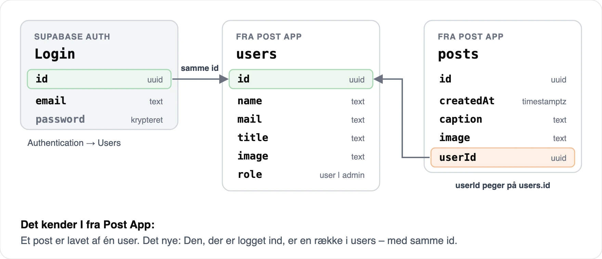

# RACE - Dynamic User Interface: User management, roller og beskyttet adgang - 10-11-2026

## Formål

I dag får I så meget tid som muligt til jeres projekt. Dagen er delt i to: Først et oplæg med demo, derefter vejledning og projektarbejde.

I oplægget zoomer vi først ud: Hvorfor Next.js – hvad får du forærende, når du bruger et framework? Derefter viser jeg den færdige app i én samlet demo: Posts har en ejer, kun ejeren kan rette og slette – i appen og i databasen – og en admin kan mere end en almindelig bruger. Bagefter kigger vi på mønstrene bag. Relationen kender I fra Post App: Et post er lavet af én user. Det nye er, at den, der er logget ind, er en række i `users`.

Bagefter arbejder I videre med jeres projekt, der hvor I er. Overvej, om I kan bruge noget fra oplægget. Vil I prøve det af, guider opgaven jer igennem hele opsætningen trin for trin i et startprojekt.

## Forberedelse

- Sørg for, at jeres Supabase-projekt ikke står som _Paused_.
- Overvej, hvilke brugerdata jeres gruppeprojekt har brug for, og hvem der må se og ændre dem.
- Genbesøg gerne relationen mellem `users` og `posts` fra Post App og Case 1 i Product optimization:
  - [Slides: Datamodellering, relationer og Supabase](https://cederdorff.com/mdu-e25ixd/slides/product-optimization-05/)
  - [Post App · `posts` og `users` med relation](https://github.com/cederdorff/post-app-supabase/tree/posts-and-users)

## Agenda

**Dagens arbejdsrytme:** Del 1: Oplæg og demo · hvorfor Next.js → den færdige app → mønstrene: posts får en ejer, kun ejeren kan rette og slette, roller. Del 2: Vejledning og projektarbejde.

### Del 1 · Oplæg og demo

<strong>1. Hvorfor Next.js? Det, et framework giver dig</strong>

<ul>
<li>Et framework er ikke bare kode, du kalder. Det kommer med funktionalitet, der allerede virker, og kalder selv din kode på de rigtige tidspunkter – <em>inversion of control</em> fra 26. oktober.</li>
<li>Hvad skulle du selv bygge i React og Vite? Routing med React Router, loading-state med <code>useState</code> og <code>useEffect</code>, fejlhåndtering, en 404-side, en server til hemmelige nøgler og login og HTML, som søgemaskiner kan læse. I Next.js er det en mappe, en fil eller en funktion.</li>
<li>Filkonventionerne i <code>app/</code>: <code>page.js</code>, <code>layout.js</code>, <code>loading.js</code>, <code>error.js</code> og <code>not-found.js</code>. Next.js pakker dem ind i hinanden, så header og footer står, når siden loader eller fejler.</li>
<li>Funktionerne, der passer til filerne: <code>notFound()</code> viser <code>not-found.js</code>, en fejl, du kaster, viser <code>error.js</code>, og <code>redirect()</code> sender brugeren videre. I dag bruger vi <code>redirect()</code>, når brugeren ikke må se en side.</li>
<li>Prisen: Du skal følge frameworkets regler. Til gengæld ser alle Next.js-projekter ens ud.</li>
</ul>

<strong>2. Den færdige app · demo</strong>

<ul>
<li>Login fra 30. oktober plus <code>users</code> og <code>posts</code> med de samme kolonner som i Post App. Hele databasen kommer fra én fil, <code>setup.sql</code> – ingen SQL at skrive. De 5 brugere fra Post App kan logge ind, fx <code>maria@example.com</code> med <code>postapp123</code>.</li>
<li>Mine posts: Sign up, opret et post med mit navn på, og log ind som Maria – hun kan kun rette og slette sine egne.</li>
<li>Databasen siger nej: En request fra Thunder Client uden om appen bliver afvist. Slår jeg RLS fra, går den igennem.</li>
<li>En admin må mere: <em>Edit</em> og <em>Delete</em> på alle posts.</li>
</ul>

<strong>3. Mønstret: Posts får en ejer</strong>

<ul>
<li>Fra <code>fetch</code> til Supabase SDK: <code>supabase.from("posts").select()</code> er det samme som jeres <code>fetch</code> fra Post App – bare kortere. SDK'et sender login'et med.</li>
<li>Startprojektet i guiden har to problemer: Nye posts får et fast <code>CURRENT_USER_ID</code>, og alle kan rette og slette alt.</li>
<li>Den, der er logget ind, er en række i <code>users</code> – med samme <code>id</code> som i login. Ved sign up opretter appen både login'et og rækken i <code>users</code> – et helt almindeligt <code>insert</code>.</li>
<li>Færdigt i startprojektet: Sign up opretter din række, og <code>getCurrentProfile()</code> henter den – navn, titel, billede og rolle.</li>
<li>Nye posts får <code>userId: profile.id</code> – den, der er logget ind, aldrig et id fra formularen.</li>
</ul>

<strong>4. Mønstret: Kun ejeren kan rette og slette</strong>

<ul>
<li>Skjul ikke bare knapper. Det, brugeren ikke må, skal også afvises på serveren – og i databasen.</li>
<li>Kun ejeren ser <em>Edit</em> og <em>Delete</em>, og siden og Server Actions tjekker det. Alligevel kan alle rette et post direkte med den publishable key fra Thunder Client – uden om alle tjek.</li>
<li>Row Level Security: Reglerne (policies) ligger klar fra <code>setup.sql</code> – fx "kun ejeren må slette". Du slår dem til med ét klik: <em>Enable RLS</em>.</li>
<li>Derfor må den publishable key ligge i frontend, når RLS beskytter data – og derfor må en secret key aldrig.</li>
</ul>

<strong>5. Mønstret: Roller – user og admin</strong>

<ul>
<li><code>users</code> har en kolonne, <code>role</code>, med <code>user</code> eller <code>admin</code>. Den kan kun ændres i <em>Table Editor</em> – ikke fra appen.</li>
<li>Admins ser <em>Edit</em> og <em>Delete</em> på alle posts – samme tjek i UI'et og på serveren, nu med <code>|| isAdmin</code>.</li>
<li>Reglerne i databasen ligger klar fra <code>setup.sql</code>: <em>Admins can update all posts</em> og <em>Admins can delete all posts</em>.</li>
</ul>

### Del 2 · Vejledning og projektarbejde

<strong>6. Arbejd videre med jeres projekt</strong>

<ul>
<li>Arbejd videre, der hvor I er i jeres projekt.</li>
<li>Overvej, om I kan bruge noget fra i dag: Har jeres data en ejer? Hvem må se og ændre hvad? Det kan I også bruge i afsnittet om it-sikkerhed.</li>
<li>Vil I prøve det af? Følg opgaven trin for trin i startprojektet <code>nextjs-supabase-posts</code> – hver opgave har en løsningsbranch.</li>
<li>Vejledning i grupperne undervejs.</li>
</ul>

## Materialer

- **Slides:**
  - [User management, roller og beskyttet adgang](https://cederdorff.com/mdu-e25ixd/slides/dynamic-user-interface-05/)
  - [PDF-version: User management, roller og beskyttet adgang](https://cederdorff.com/mdu-e25ixd/slides/dynamic-user-interface-05/?print-pdf)
- **Guide:**
  - [User management og beskyttet adgang](https://github.com/cederdorff/mdu-e25ixd/blob/main/undervisning/dynamic-user-interface/opgave-2026-11-10-user-management-roller-og-rls.md) – trin for trin i et startprojekt, med hints og løsninger · opgave 1–5
- **Løsningsrepo:**
  - [nextjs-supabase-posts](https://github.com/cederdorff/nextjs-supabase-posts) – template med startprojektet på `main` og én løsningsbranch pr. opgave
- **Next.js:**
  - [Project structure](https://nextjs.org/docs/app/getting-started/project-structure) – oversigt over alle filkonventioner
  - [Error handling](https://nextjs.org/docs/app/getting-started/error-handling)
  - [loading.js](https://nextjs.org/docs/app/api-reference/file-conventions/loading)
  - [not-found.js](https://nextjs.org/docs/app/api-reference/file-conventions/not-found)
  - [redirect](https://nextjs.org/docs/app/api-reference/functions/redirect)
  - [Inversion of Control](https://martinfowler.com/bliki/InversionOfControl.html) (Martin Fowler)
- **Supabase:**
  - [Row Level Security](https://supabase.com/docs/guides/database/postgres/row-level-security)
  - [Understanding API keys](https://supabase.com/docs/guides/api/api-keys)
  - [JavaScript: Fetch data](https://supabase.com/docs/reference/javascript/select) og [Insert data](https://supabase.com/docs/reference/javascript/insert)
